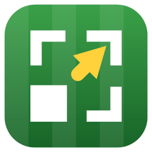

# A2G-Scaler



Play **Anstoss 2 Gold** at any size. The game is hard-wired to 640×480 pixels; A2G-Scaler upscales
its window to fill any window or screen, and mouse and keyboard work just as they normally do.

User guide (in German): <https://transfairs.github.io/A2G-Scaler/>

Like the game itself, the user interface is in German.

## Getting started

**Quickest way:** copy `A2G-Scaler.exe` into the game folder (next to `anstoss2.exe`, or `run.exe`
in the GOG release) and run it. It asks whether to launch the **game** or the **data editor**
(*Dateneditor*), starts it in windowed mode and quits when you close it. If the game or the editor is
already running, the scaler simply attaches to it.

If you keep the scaler in a different folder:

1. Start Anstoss 2 Gold **in windowed mode**, i.e. **without** the `/f` switch in the shortcut.
2. Start `A2G-Scaler.exe` (in either order). The scaler finds the game on its own and reattaches
   whenever the game is restarted.

**Fully automatic (optional):** if you also put the included `dsound.dll` into the game folder, the
scaler launches by itself whenever you start the game or the editor, and closes along with it. You
never have to run `A2G-Scaler.exe` yourself, but it has to stay in the folder. To turn this off,
delete `dsound.dll`. See [dsound-proxy/README.md](dsound-proxy/README.md) for details. If the game is
started in full screen (`/f`), the scaler stays out of the way.

Then move the mouse into the picture and play. To get the mouse back, push it firmly against an edge
of the picture or press **Ctrl+Alt+S**.

| Hotkey (configurable) | Action |
|---|---|
| Ctrl+Alt+S | Release the mouse from the game |
| Ctrl+Alt+F | Toggle full screen |
| Ctrl+Alt+M | Next scaling mode |
| Ctrl+Alt+L | Show/hide the toolbar |

The hotkeys are system-wide, so they work even while the game has keyboard focus. You can change
them via **Tastenkürzel …** in the toolbar.

**Scaling modes:** *Einpassen (scharf)* (sharp fit, the default: nearest-neighbour up to the next
integer multiple, then smoothly down to the window size), *Einpassen (pixelgenau)* (pixel-perfect
fit), *Einpassen (weich)* (smooth fit), *Integer (pixelgenau)* (pixel-perfect integer scaling with
black borders).

**Toolbar:** ✕ (hides the toolbar; Ctrl+Alt+L brings it back, and it always reappears on the next
start), scaling mode, full screen, statistics, *Popups zentrieren* (the game opens its message boxes
in the middle of the screen rather than over the game; this option moves them back), *Tempo-Ausgleich*
(slows the in-game mouse down by the zoom factor so it doesn't feel too fast), hotkeys, about.

## Good to know

- Supports the original CD release, the 2007 re-release and the GOG release (game and data editor).
- If the game runs **as administrator**, A2G-Scaler has to run as administrator as well; otherwise
  Windows won't let it control the game. The scaler tells you when this is the case.
- Settings and the log file are stored in `%LocalAppData%\A2G-Scaler\` (on Windows XP:
  `Local Settings\Application Data\A2G-Scaler` in your user profile). The about dialog has a link to
  the folder.
- If the scaler crashes, it puts everything back on the next start: mouse speed, game window
  position, the game's taskbar button and, on XP/Vista, the system cursors (`recovery.ini`).
- Requirements: Windows XP SP3 or later and .NET Framework 4.0 or later (the Client Profile is
  enough). Tested on Windows 10/11; [TECHNICAL.md](TECHNICAL.md#older-windows-versions) explains what
  is different on XP, Vista and 7.

## How it works

In short (details and pitfalls in [TECHNICAL.md](TECHNICAL.md)):

- **Picture:** all visible windows of the game are captured with `GetDCEx`/`BitBlt` (this works even
  while they are covered, in about 4–5 ms), composited in z-order and scaled with `StretchBlt` or a
  custom sharp-bilinear scaler. Title bars, which DWM draws, come from a `PrintWindow` cache.
- **Mouse:** the same approach as [Magpie](https://github.com/Blinue/Magpie) (no code borrowed). The
  game window sits hidden behind the scaler, which lets clicks pass through. The real cursor is moved
  to the matching spot in the game and confined there, the system cursor is hidden, and the game's
  cursor is drawn into the scaled picture instead.

## Building

Visual Studio 2019 or later (or the Build Tools) with the ".NET desktop development" workload:

```
msbuild A2G-Scaler.csproj /restore /t:Rebuild /p:Configuration=Release /p:Platform=x86
```

This produces `bin\x86\Release\A2G-Scaler.exe`. The optional `dsound.dll` is built with
`dsound-proxy\build.cmd` (requires the C++ workload).

The tests (`A2G-Scaler.Tests`, xUnit) need the MSBuild that ships with Visual Studio 2022. Run
restore and build as separate steps:

```
msbuild A2G-Scaler.Tests/A2G-Scaler.Tests.csproj /t:Restore
msbuild A2G-Scaler.Tests/A2G-Scaler.Tests.csproj /t:Build
dotnet test A2G-Scaler.Tests/A2G-Scaler.Tests.csproj --no-build --no-restore
```

## Releases

Pushing a `vX.Y.Z` tag triggers `.github/workflows/release.yml`: it runs the tests, builds with the
version taken from the tag and publishes a GitHub release containing the exe, `dsound.dll` and
`A2G-Scaler-Latest.zip`. The project page in `help/` is deployed by `.github/workflows/pages.yml`.

## License

[GNU General Public License v3.0](LICENSE).
